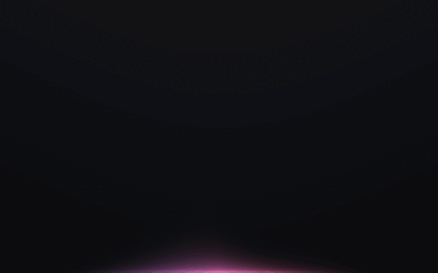

# Edge Glow

**An Apple Intelligence / Siri-style glow around your screen edge while you dictate
with [Voxtype](https://github.com/peteonrails/voxtype) on [Omarchy](https://omarchy.org).**



- **Listening:** the glow rolls up from the bottom edge, then blue, violet, pink and
  orange drift around the screen, swelling and brightening with your voice.
- **Transcribing:** it settles into a steadier shimmer.
- **Done:** it fades out and the overlay is hidden. Nothing renders between dictations.

It's click-through, never takes keyboard focus, and runs inside the existing Omarchy
shell, with no extra process.


<sub>The preview images are rendered from the same shader over a plain background.</sub>

## Requirements

- Omarchy 4.x (Quattro shell)
- Voxtype 1.0.1 or newer, with `/usr/bin/voxtype-audio-bridge`

## Install

```sh
omarchy plugin add https://github.com/KaiCryan/omarchy-edge-glow --enable
```

Then turn off Voxtype's own on-screen pill so the two don't stack. Add this to
`~/.config/voxtype/config.toml`:

```toml
[osd]
enabled = false
```

and restart Voxtype: `systemctl --user restart voxtype`.

Try it without dictating:

```sh
omarchy-shell edge-glow preview recording 8
```

## Settings

Optional, in `~/.config/omarchy/edge-glow.json`. Changes apply live.

```json
{ "palette": "apple", "width": 34, "intensity": 1.0, "radius": 14, "monitor": "focused" }
```

| Key | Default | |
|---|---|---|
| `palette` | `"apple"` | `"apple"` or `"theme"` (uses your Omarchy theme's colours) |
| `width` | `34` | How deep the glow reaches, in px (6–160) |
| `intensity` | `1.0` | Brightness (0.1–3) |
| `radius` | `14` | Corner radius in px (0–80) |
| `monitor` | `"focused"` | `"focused"`, `"all"`, or an output name like `"eDP-1"` |

## Commands

```sh
omarchy-shell edge-glow preview recording 8     # preview the listening glow
omarchy-shell edge-glow preview transcribing 4  # preview the transcribing shimmer
omarchy-shell edge-glow preview idle 1          # stop a preview
omarchy-shell edge-glow status                  # current state and settings
```

## How it works

`VoxtypeState.qml` watches Voxtype's state file (`$XDG_RUNTIME_DIR/voxtype/state`).
While you're recording, `AudioLevel.qml` reads microphone frames from
`voxtype-audio-bridge` and normalises them to a 0–1 loudness. `GlowSurface.qml` draws
a transparent overlay with the `glow.frag` shader: a crisp rim, a bright band and a
soft haze, coloured by a gradient that drifts around the edge.

The shell loads the compiled `glow.frag.qsb`. After editing `glow.frag`, rebuild it
(needs `qt6-shadertools`):

```sh
/usr/lib/qt6/bin/qsb --qt6 --qsbversion 65 -O -o glow.frag.qsb glow.frag
```

## Uninstall

```sh
omarchy plugin remove kaicryan.edge-glow
```

Then remove the `[osd]` lines from your Voxtype config, or set `enabled = true`.

## Credits

The Voxtype state and audio-bridge handling follows the approach of
[Aura Voxtype HUD](https://github.com/Sh3nron/omarchy-aura-voxtype-hud) (MIT).

## License

[MIT](LICENSE)
